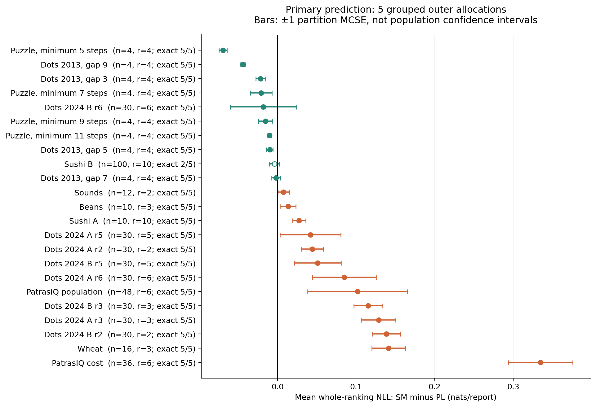
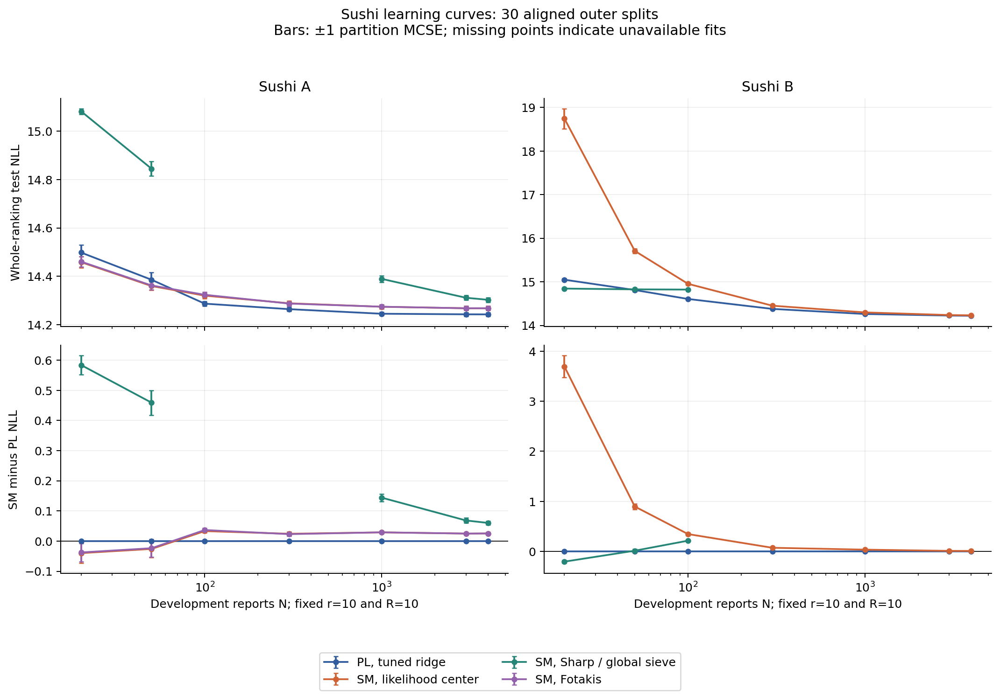
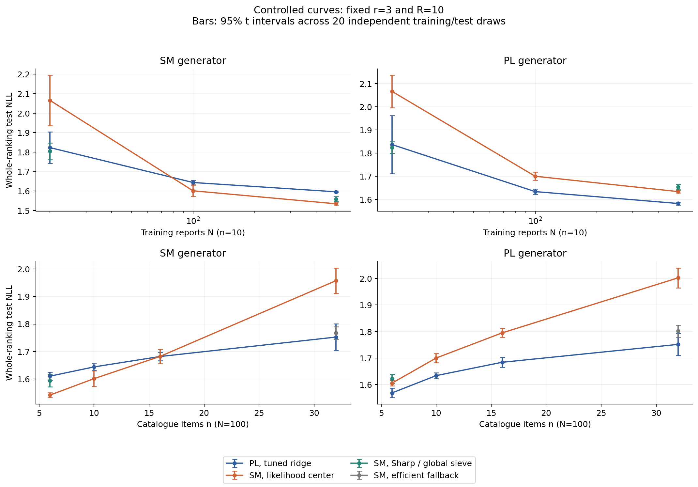

# Findings across the study

[Design](experiments.md) · [Data](../data/README.md) · [Criteria](criteria.md) · [Uncertainty](uncertainty.md) · [Complete tables](../results/README.md)

Throughout, $`\Delta=\mathrm{NLL}(\mathrm{SM})-\mathrm{NLL}(\mathrm{PL})`$; negative favors SM. The conclusions below concern specified fitted procedures and evaluation populations. Predictive advantage does not identify a generating model, and loss magnitudes across different ranking lengths are not directly comparable measures of dataset importance.

## Main experiment: Algorithm 4.1 (P0)

The main [P0 comparison](predictive_comparison.md) has **30 finite paired predictions for every one of the 23 tasks**, using 80% development data, training-only PL tuning and bounded SM dispersion. [The independent main report](../results/main/README.md) contains the complete two-method table and detailed P0 analysis. [E0](../results/estimator_comparison/README.md) separately reports the other center estimators. A negative delta favors SM; the error bars below are partition MCSEs, not population confidence intervals.

The likelihood-center SM mean favors SM in the eight Dots 2013/Puzzle conditions and dots2024 B at r=6, and favors PL in the other fourteen tasks. These are directions of observed means, not twenty-three independent significance decisions. Puzzle minimum five steps has delta −0.05855 (MCSE 0.00365); dots2024 B r=6 has −0.04621 (0.01352). PatrasIQ cost has +0.28339 (0.01974) and wheat +0.15917 (0.01337). Raw magnitudes across different r are not a common effect-size scale.

All 30 likelihood centers are certified for 22 tasks. **Sushi B is the exception:** only 5/30 have an exact certificate; the others retain explicitly approximate centers and objective bounds. Its mean delta +0.00975 (MCSE 0.00509) is therefore a comparison of the recorded fitting procedures, not an exact-MLE family comparison. Its median training-objective bound gap is 1,014 inversions, with maximum 1,107; these are optimization bound gaps, not bounds on test loss or actual distance to an optimal order. dots2024 B r=5 also has a small mean +0.01198 relative to its partition MCSE 0.01465. Neither case supports a broad model-winner claim.

The marker is hollow where not all likelihood centers have exact certificates. All predictors retain the complete task catalogue. Regularization makes the PL predictions finite; it does not establish independent people in anonymous sources, remove mixture effects or prove that one probability family generated the data.

## Supplementary estimator comparison (E0) and global sieve (B0)

Sharp completes all thirty E0 fits for **11 tasks**: Beans, Sushi A, Sounds, the four Dots 2013 conditions and the four Puzzle conditions. This includes ten- and twelve-item catalogues. The other twelve tasks have explicit sieve resource failures rather than an eight-item exclusion. [The resource account](sieve_computation.md) distinguishes the exact full-space shortcut, complete nontrivial packings, and memory/time failures.

All empirical tasks satisfy the chosen fixed report-size bound R=10. Their Sharp pilot has zero depth and their terminal block covers the catalogue, making the B0 global sieve identical under the shared pair-selection seed. Its 330 available rows are aliases of the 330 Sharp fits, not additional replications. Efficient is used only for the 60 dots2024 r=2 contexts where Sharp fails and lambda<=1. Fotakis passes complete-pair admission in 416 of 690 contexts; its task-specific denominators remain visible.

Center choice changes some predictions. For example, the E0 Beans Sharp difference is +0.00314 versus +0.01275 for the likelihood center. Sushi A Sharp gives +0.06029 versus +0.02543 for the likelihood center. These are prespecified estimator comparisons on the same reports, not a rule that selects whichever center wins on the outer test.

Increasing the completion budget to 30 minutes and 4 GiB, together with equivalent exact packing algorithms, recovers **100 Sharp fits** in the learning and synthetic cells. It does not recover additional E0 Sharp tasks. The remaining 530 unavailable Sharp contexts comprise 360 E0, 90 L0 and 80 S0 fits. They are not missing Algorithm 4.1 main results. The published ball-cover retry records their memory-admission failures; the separate streaming-computation work records subsequent search attempts. These are completion outcomes for the same experiment, with unchanged data, allocations and estimator definition; the [resource account](sieve_computation.md#completion-results-and-remaining-limits) lists their locations.

## Supplementary training-size and catalogue-size experiments (L0/S0)

The [L0 Sushi curves](predictive_learning.md) use thirty aligned outer tests and nested development budgets. Sushi A's likelihood-center SM difference is −0.03976 at N=20, −0.02594 at N=50, and +0.03324 at N=100; it is +0.02499 at N=3000. Thus the observed comparison direction changes with budget. Sushi B's corresponding difference falls from +3.69397 at N=20 to +0.34730 at N=100 and +0.01149 at N=3000. Its large-catalogue center approximations and small-budget item coverage remain part of that procedure, not negligible details.

Sushi A now also has complete Sharp results at every budget. The recovered Sharp-minus-PL means are +0.45598 at N=100 (partition MCSE 0.03004) and +0.21617 at N=300 (0.02240). Computational recovery does not imply predictive superiority: these means favor PL. Sharp's selected-pair objective uses only one sampled pair per report, so it is not the same fitted procedure as the whole-ranking likelihood center.

S0 supplies independent known-generator controls with fixed r=3 and R=10. Under an SM generator at n=10, likelihood-center SM has delta +0.24261 at N=20, −0.04265 at N=100 and −0.06156 at N=500. Mean true-center Kendall error falls from 12.35 to 2.95 to 0.15. The center is exact in these n=10 fits. Even a correctly specified probability family can lose at small N when estimation and regularization dominate, so a finite-sample predictive winner does not identify the generating law.

All 240 S0 likelihood-center fits, including n=32, have exact objective certificates. The synthetic catalogue-size pattern below therefore does not arise from an uncertified center optimization result.

The recovered n=10,N=100 Sharp results have mean delta +0.01712 under the SM generator, with 95% independent-repetition interval [−0.01117,+0.04540], and +0.08445 under the PL generator, with interval [+0.06678,+0.10212]. Mean center Kendall errors are 6.55 and 9.75 respectively; the latter is an ordering error under a PL law, not SM minimax risk.

At fixed N=100 under the SM generator, the likelihood-center delta is −0.06870 at n=6, −0.04265 at n=10, approximately zero at n=16, and +0.20505 at n=32. Increasing catalogue size with a fixed data budget changes exposure and estimation difficulty. Under the PL generator, the recorded likelihood-center SM comparison favors PL in every S0 design cell. The PL generator keeps its total log-worth range fixed, so adjacent strength gaps decrease as n grows; this declared design choice qualifies the catalogue-size interpretation.

S0 bars are 95% Student-t intervals over twenty independent training/test draws; L0 bars are partition MCSEs of fixed data. Missing Sharp points are resource failures, not zero errors. [Supplementary L1/L2/S3](learning_curves.md) retain shrinkage, fixed-penalty and broader exposure controls without treating them as extra repetitions of L0/S0.

## Full-data ranking characteristics

[All three features beside primary NLL](../data/features/predictive_comparison.md) use unchanged full-data reference centers and frequencies. Dots 2013 and Puzzle have equal-gap pair-rate dispersion H of about 1.00–3.34 percentage points with dense repeated support; their eight P0 mean gaps favor SM. Sushi A has H=7.36 points and a PL-favorable mean. These related tasks do not establish a general feature-to-winner law.

Within-display/shell variation must be read against support. Sushi A's mean TV is .99351, but its nominal iid-uniform sampling reference is already .99335 because the possible-order space is huge. Raw TV near one alone is uninformative about model violation. That nominal reference is not a calibrated test after data-dependent center estimation or repeated-assessor sampling.

Changing-display features are likewise descriptive. Beans has a +2.66-point one-item replacement effect over 420 contrasts with repeated displays on both sides, yet its primary NLL favors PL. Wheat's +7.56-point effect has repeated support in only 70 of 2,022 contrasts. dots2024 B r=6 has large H=23.36 points with sparse cells and still favors SM in P0. Mixtures, center estimation and unequal sampling support prevent these features from being interpreted as isolated causal explanations. Fixed full displays have no same-pair changing-display contrast; r=2 has no nontrivial within-shell contrast.

## Estimator risk and theorem correspondence

[The theory chapter](theory_alignment.md) maps the manuscript's minimax regimes to these and the supplementary results. Real-data NLL and distance to an external objective order are not true-center Kendall risk. S0's correctly specified SM center errors are more directly relevant, but average random-center error on a finite grid is not a worst-case or asymptotic minimax verification. Its n=10 sample-size curve is numerically outside the lambda<=1 part of Corollary 2.15; fixing R is necessary for that statement, not sufficient.

The active Sharp implementation keeps A=256 and W_star while removing the eight-item guard. Computability of the exact global sieve is a separate issue from its statistical rate. All successful efficient runs still have depth zero, so they do not test an active multilevel hierarchy. The supplementary complete-ranking results and [Theorem 2.17/Fotakis comparison](theory_alignment.md#theorem-217-versus-fotakis-posest) retain their tie-rule and target distinctions.

The supplementary [P1 unpenalized comparison](repeated_holdout.md) records fit-existence failures and exact-certificate exclusions. P2 adds fixed-fit diagnostic and test-unit bootstrap results. Their data overlap with P0, and P0 changes both development size and regularization, so differences between the tables do not isolate a pure penalty effect or constitute independent replications.

## Trial and assessor heterogeneity

At the same training count, local Puzzle fitting improves both SM and PL by approximately .11–.14 nats per report relative to matched pooled training. With the much larger full pooled training sample, that local advantage usually disappears. Relative SM–PL interactions change sign across Puzzle conditions and all their 70/30 split ranges include zero. Group information can improve prediction without establishing that one family is consistently more group-sensitive.

The Sounds person-local setting has only 21 training pairs per assessor. A usable finite PL fit exists in 28 of 4,600 local contexts; SM also has missing-item exclusions and infinite test losses. The tiny finite intersection cannot support an overall personal-model winner. Pooled prediction for held-out people remains a meaningful separate target. [G1](group_sensitivity.md) provides per-condition tables, equal-budget controls, coverage and 5th–95th split ranges.

## Controlled mechanisms

S1's fixed-shell intervention isolates an aspect of ranking structure that total noise does not describe. For n=8,r=3,N=448 and equal-gap reference PL, every intervention retains mean inversions .826685 and the full inversion-count distribution, yet the mean exact-SM-minus-PL difference changes as follows:

| Within-shell tilt h | Mean Δ | 95% interval across 40 independent training draws |
|---:|---:|---|
| 0 | −.0555 | [−.0577,−.0533] |
| .5 | −.0270 | [−.0295,−.0245] |
| 1 | −.0026 | [−.0052,.0000] |
| 2 | +.0388 | [.0350,.0426] |
| 4 | +.0708 | [.0685,.0732] |

The final displayed zero is rounded. The conclusion is a controlled predictive reversal as probability allocation within shells changes, not proof that a single empirical context slope identifies the preferred model. The bridge, shell and coverage grids preserve finite-MLE failures and divergent losses. At n=32,N=40, all PL fits in each coverage mixture cell lack a unique finite MLE. [Simulation design and exact outputs](strict_feature_analysis.md).

## Diagnostic calibration

Estimated-center error attenuates or changes the apparent SM context effect. The heterogeneous-PL control produces a nonzero pooled effect through assessor/display association even though each group is PL and has zero within-group context effect. Adjusting by true group removes the population effect, but its sample bootstrap can fail when overlap is sparse.

At confounding strength .90 and diagnostic budget 60, only 143/200 adjusted diagnostics exist, and 30.8% of those reject the true zero effect using nominal 95% intervals. At budgets 200 and 1,000, availability/rejection are 199/200 with 7.5% and 200/200 with 3.0%. This is evidence against treating the diagnostic's nominal interval as a universally calibrated test. [D2](validation_extension.md) distinguishes inner bootstrap intervals from outer Wilson rate intervals.

Wheat's context support is small and its clustering metadata incomplete. The SP-Rank objective-gap screen has no eligible changing-gap pairs. No reliable positive empirical identification of the selective-Mallows context mechanism follows from these analyses. [Observation-design limits](context_followup.md).

## Temporal and structural controls

ATP's ten equal-weight season means favor ridge PL: the bounded/shrunk efficient-center SM difference is +.02455 with working across-season interval [.01497,.03412]. Fixing SM to PL's fitted order still gives +.02169 [.01340,.02997]. This is consistent with pair-specific strength differences helping beyond a common order. The intervals do not resolve dependence from recurring players and years. [Temporal design and tables](temporal_prediction.md).

On Sushi A, a common-order control still favors PL in a conditional comparison; within-shell probabilities can help even when the fitted order is held fixed. Optimization benchmarks and Sushi B objective bounds explain which comparisons are exact and which use approximations. Their bounds apply to training objectives, not predictive loss. [Structural controls](structural_controls.md).

These findings leave distinct open questions: sampling-population uncertainty for the complete repeated-fit procedure, unidentified participant dependence, uniform-display theorem applicability, performance of active multilevel estimator hierarchies, and robust model selection from sparse context data. The study records these limitations alongside the results rather than treating repeated shuffles as additional people or corrected metadata as new observations.
