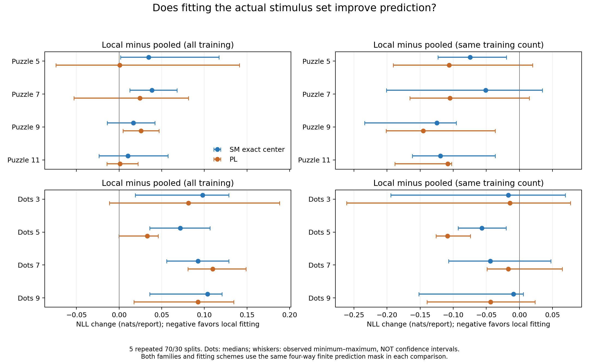
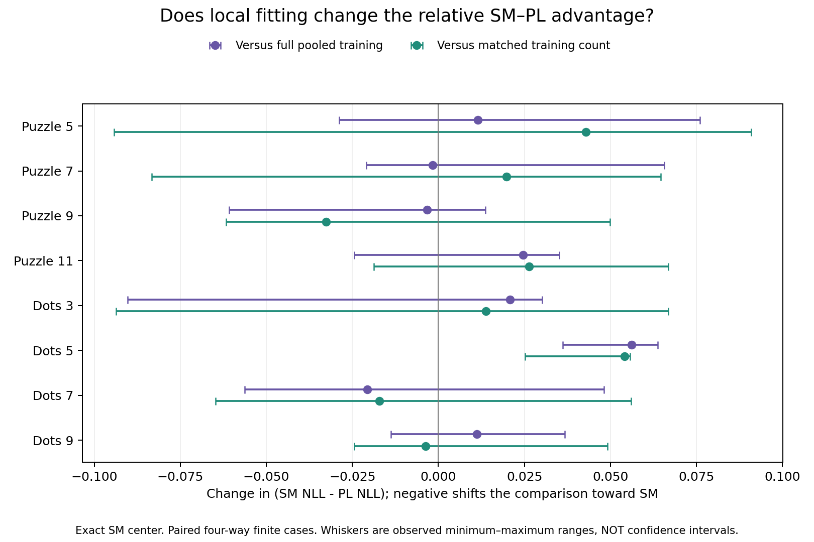

# Trial and assessor heterogeneity

[Experiment G1](experiments.md) · [Data and identities](../data/dots_puzzle.md) · [Criteria](criteria.md#group-comparisons-and-aggregation) · [Uncertainty](uncertainty.md#group-split-percentiles) · [Outputs](../results/group_sensitivity/README.md)

This supplementary experiment separates the effect of training count from the predictive value of trial or assessor identity. All comparisons retain unavailable or infinite predictions and disclose the finite cases used in each aggregate.

## Observations and group identity

The original [author data page](https://www.andrewmao.net/code/) links [voting-results.tar.gz](https://dl.dropboxusercontent.com/s/mf0mm153pe3f12w/voting-results.tar.gz), SHA256 `2906b0ce3fc375813f7fd061e55fd642e6e9ac472a385a56d2b8e36ef838e0d4`. Its 40 files per condition identify repeated physical stimulus sets. All 24 ranking frequencies exactly match each of the eight pinned PrefLib files. Puzzle contributes 3,180 reports; Dots (2013, **not dots2024**) contributes 3,183. Each report ranks all four presented items. The four difficulty conditions in each family are fitted separately.

A local trial uses its fixed four physical stimuli, whereas pooled item labels identify difficulty categories across trials. Actual board layouts, globally unique board IDs and cross-trial assessor IDs remain unavailable. Trial membership does not establish assessor independence or prove that no stimulus was reused elsewhere. Sounds contributes 46 source-identified assessors with 30 pair reports each over 12 items (1,380 reports). The pinned BayesMallows source and download hashes are retained in the data manifests. Other tasks do not provide both reliable group identities and within-task per-person repetitions for this design. Different catalogs/tasks are not combined to manufacture repetitions.

## Design and fitting

The [estimator comparison](theory_alignment.md#g1-and-c1-where-fotakis-was-actually-compared) summarizes every saved Fotakis-versus-exact NLL contrast and its denominator. It also explains why Fotakis's majority construction is close to Theorem 2.17 but differs on tied pairs; agreement on these tasks does not prove general algorithmic equivalence.

Root seed `202609270` uses separate streams by task, fraction, repeat, purpose and group. Use five repetitions, IDs 0–4, for each 70/30, 50/50 and 80/20 within-group split. Every group contributes floor(fraction × count) intact training reports, with the remainder held out. No split is rerolled for coverage or fit existence. [Current execution specification](protocols/GROUP_SENSITIVITY_20260927.md).

For identical test reports, compare (1) pooled training on all groups, (2) local training on the target group, and (3) matched_pool, a uniform without-replacement subsample of pooled training with exactly the local training count. Matched training can contain target-group reports. All methods share each context's training and test memberships. Group labels route local predictions but are not covariates in either ranking law. Local prediction requires known group identity and increases total model capacity.

A separate five whole-group 70/30 holdouts evaluates transfer to unseen trials/assessors using pooled fits. It is a different predictive target, not paired report-for-report with within-group evaluation. Within-assessor evaluation predicts additional reports of known people; it is not a new-person split. Trial holdout cannot establish person disjointness without person IDs.

Unchanged conditional likelihoods, unbounded SM profile beta and unpenalized Hunter MM are used. Infinite SM losses and undefined/nonconverged PL fits remain explicit. No beta cap, pseudodata, removed catalog items, test-driven method selection or repaired split is introduced. This is the declared unregularized variant, not a literal implementation of the entirety of manuscript Algorithm 4.1.

- **Exact SM center:** exact subset DP for n=4 and n=12; cardinality batching preserves the recurrence, objective and seeded tie order. No approximate substitute was needed. G1 conservatively excludes fits with unseen catalog items. Full pair coverage is not necessary for a Kemeny minimizer to exist; sparse ties/nonidentifiability remain limitations.
- **Fotakis Algorithm 1 / PosEst:** majority-predecessor counts, counting equal-count pair ties in both directions, fixed seeded random score-tie order. Admit only training sets containing every item pair; record empirical p=min(pair count)/N. This structural check does not certify the paper's true-model or sample-size recovery guarantees. Profile beta is then fitted by the same likelihood.
- **Sharp / efficient:** the specified policy conservatively excludes $`\lambda=Nr(r-1)/(n(n-1))>1`$, outside the manuscript's sparse theorem regime. This is a theorem-domain admission choice, not a claim that Sharp is mechanically undefined outside that regime. Consequently Sharp/efficient are excluded for full four-item trials. Sounds local data can satisfy $`\lambda\le1`$; n=12 exceeds the size-8 exact sieve guard, so the specified Section 3 fallback is used when every item appears. All successful efficient fits had hierarchy depth zero. Uniform subset sampling, independent reports, true $`\beta\ge0.1`$ and the unknown sufficient constant $`C_0`$ are not verified; $`\mu/\log(er)>1`$ is not a certificate.
- **PL:** requires directed strong connectivity and the unchanged numerical convergence checks. An unavailable finite unique MLE is not assigned an invented predictive score.

## Group comparison results

Delta is exact-center SM minus PL NLL, in nats/report; negative favors SM. Each mean uses five 70/30 allocations. These scheme-specific values use paired finite reports, so they are conditional where coverage is incomplete. Cross-scheme contrasts below use a stricter shared four-way mask.

| Task | Pooled delta | Local delta | Matched-pool delta | Whole-group holdout delta | Local paired coverage |
|---|---:|---:|---:|---:|---:|
| puzzle-5 | -0.06292 | -0.04439 | -0.06245 | -0.06516 | 99.53% |
| puzzle-7 | -0.00526 | +0.01028 | +0.00229 | -0.02635 | 99.05% |
| puzzle-9 | -0.01260 | -0.02788 | -0.01441 | -0.00683 | 99.44% |
| puzzle-11 | -0.01572 | -0.00463 | -0.02368 | -0.01770 | 100.00% |
| dots-3 | -0.01258 | -0.01099 | -0.01322 | -0.01468 | 100.00% |
| dots-5 | -0.01512 | +0.03572 | -0.01256 | -0.01191 | 100.00% |
| dots-7 | -0.00560 | -0.02574 | -0.01322 | -0.01389 | 100.00% |
| dots-9 | -0.03063 | -0.02185 | -0.02295 | -0.02348 | 100.00% |
| sounds | +0.01390 | +0.26688 | -0.15434 | +0.00049 | 0.43% |

## Training-budget control and model sensitivity

For each target group, compare local and reference predictions on the same reports with all four losses finite (SM/PL × local/reference). The matched pool is sampled without replacement from pooled training, with the local training count. Negative local-minus-reference changes favor local fitting. The interaction is (SM_local − PL_local) − (SM_reference − PL_reference); negative shifts the comparison toward SM.

| Task | Reference | SM change | PL change | Interaction | Observed interaction min–max | Four-way coverage |
|---|---|---:|---:|---:|---|---:|
| puzzle-5 | pooled | +0.04288 | +0.02363 | +0.01925 | [-0.02877, +0.07604] | 99.53% |
| puzzle-5 | matched_pool | -0.07461 | -0.09006 | +0.01545 | [-0.09425, +0.09086] | 99.05% |
| puzzle-7 | pooled | +0.03763 | +0.02259 | +0.01504 | [-0.02098, +0.06565] | 99.05% |
| puzzle-7 | matched_pool | -0.07430 | -0.08145 | +0.00715 | [-0.08330, +0.06454] | 99.05% |
| puzzle-9 | pooled | +0.01092 | +0.02598 | -0.01507 | [-0.06086, +0.01371] | 99.44% |
| puzzle-9 | matched_pool | -0.14480 | -0.13079 | -0.01401 | [-0.06167, +0.04980] | 99.44% |
| puzzle-11 | pooled | +0.01660 | +0.00551 | +0.01108 | [-0.02451, +0.03506] | 100.00% |
| puzzle-11 | matched_pool | -0.10841 | -0.12745 | +0.01905 | [-0.01873, +0.06673] | 100.00% |
| dots-3 | pooled | +0.08563 | +0.08404 | +0.00159 | [-0.09036, +0.03018] | 100.00% |
| dots-3 | matched_pool | -0.03870 | -0.04094 | +0.00223 | [-0.09369, +0.06675] | 100.00% |
| dots-5 | pooled | +0.07386 | +0.02302 | +0.05085 | [+0.03608, +0.06378] | 100.00% |
| dots-5 | matched_pool | -0.05234 | -0.10062 | +0.04828 | [+0.02513, +0.05577] | 100.00% |
| dots-7 | pooled | +0.09573 | +0.11588 | -0.02015 | [-0.05630, +0.04812] | 100.00% |
| dots-7 | matched_pool | -0.02339 | -0.01086 | -0.01252 | [-0.06481, +0.05597] | 100.00% |
| dots-9 | pooled | +0.09132 | +0.08254 | +0.00878 | [-0.01378, +0.03667] | 100.00% |
| dots-9 | matched_pool | -0.04571 | -0.04681 | +0.00110 | [-0.02448, +0.04920] | 100.00% |
| sounds | pooled | +0.70417 | +0.44407 | +0.26010 | [+0.26010, +0.26010] | 0.43% |
| sounds | matched_pool | NA | NA | NA | [NA, NA] | 0.00% |

The five-value range is descriptive, not a population confidence interval or a calibrated test. Equal-budget improvements do not imply that a local model beats the much larger pooled sample. Relative SM–PL changes depend on the condition and sampled allocation. These observational comparisons cannot isolate a causal board or person effect; local routing also changes effective model capacity.





The [complete tables](../results/group_sensitivity/README.md) include 50%, 70% and 80% training fractions, report-weighted and equal-group summaries, and separate method coverage. [Fotakis versus exact](../results/theory_alignment/g1_fotakis_vs_exact.csv) compares center estimators; no test winner is substituted for the reference estimator.

## Sounds and dependent observations

Each local 70/30 context has 21 training and nine test pairs for one of 46 assessors. Across five repetitions there are 230 local training contexts. The finite-MLE and item-coverage audit is:

| Method | Fit status | Contexts |
|---|---|---:|
| pl | no_unique_finite_mle | 229 |
| pl | ok | 1 |
| sm_efficient | ok | 205 |
| sm_efficient | unseen_catalog_items | 25 |
| sm_fotakis | not_p_frequent | 205 |
| sm_fotakis | unseen_catalog_items | 25 |
| sm_mle | ok | 205 |
| sm_mle | unseen_catalog_items | 25 |
| sm_sharp | exact_sieve_unavailable | 205 |
| sm_sharp | unseen_catalog_items | 25 |

An available SM fit can still assign zero probability to a test ranking; those infinite losses are recorded separately. Small finite intersections cannot estimate overall personal predictive risk. Within-assessor prediction targets further reports of known people, while whole-person holdout targets unseen people. Stable latent person characteristics can induce dependence; adding other people's reports does not remove it. Unknown cross-trial assessor identities remain unresolved.

## Availability, validation and reproduction

The study contains 11,160 training contexts and 55,800 candidate statuses across nine tasks. Public outputs contain 2,250 repeat-score rows. All repeat IDs are 0–4. Finite conditional results do not establish finite unconditional risk. Tables use means; figures use medians and observed minima/maxima. No independent-split population t-test is used.

Source checks reconcile every original Dots/Puzzle ranking frequency. Full replay verifies group membership, disjoint training/test reports, matched training counts, stored predictions and four-way masks without fitting again. Public-only validation checks hashes and all repeat aggregation. Detailed per-report caches and original data stay local.

```bash
python run_group_sensitivity.py --workers 4
python validate_group_sensitivity.py
python validate_group_sensitivity.py --repository-only
python make_group_sensitivity_figures.py
```
