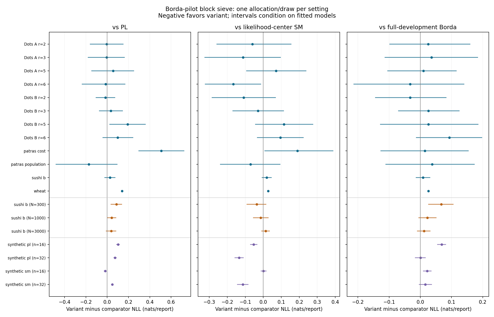

# Borda-pilot tuned block sieve: a single-allocation supplement

[Study guide](../README.md) · [Original Sharp computation](sieve_computation.md) · [Main Algorithm 4.1 results](../results/main/README.md) · [Protocol](../results/tuned_block_sieve/protocol.json) · [Scores](../results/tuned_block_sieve/scores.csv) · [Validation candidates](../results/tuned_block_sieve/candidates.csv) · [Paired comparisons](../results/tuned_block_sieve/comparisons.csv)

## Question and result

Can a global Borda pilot and validation-selected small blocks produce a usable predictor for the catalogue/budget settings where the literal Sharp estimator could not be computed? The answer here is computationally yes in **19/19 settings**. This is a **Borda-pilot block-sieve variant**, not a completion of manuscript Sharp and not the main experiment. The original Sharp's unavailable entries remain unchanged.

Across the twelve empirical full-budget tasks, the variant has lower test NLL than PL in **5/12**, likelihood-center SM in **6/12**, full-development Borda in **2/12**, and its own pilot-only Borda in **8/12**. These are descriptive counts of tasks, not independent votes or a significance test. Zero differences, if any, are not counted as wins. Every comparison uses identical held-out reports within a setting.

The most negative empirical SM-variant-minus-PL gap is **patras population: -0.17305 nats/report**; the most positive is **patras cost: +0.50797**. Conditional 95% intervals lie wholly below zero in 0 empirical tasks and wholly above zero in 2; this is exploratory, with no multiplicity correction. Test sets were also used by existing repository experiments, so this is not a fresh confirmatory study.

## Scope, data and the single allocation

The target list is frozen from the active E0/L0/S0 Sharp resource failures at repository commit `80e246692d741eba54b06f380614f3396cb8d9f9`. The 155 unavailable contexts correspond to 19 distinct task/budget/generator cells: 12 empirical tasks × 5 allocations, 3 Sushi B budgets × 5 allocations, and 4 simulated cells × 20 independent draws. This supplement uses **ID 0 once in each cell**, without searching across IDs. Global-sieve B0 aliases are not counted again. The separate P1/P2 implementation-size guards are not new unresolved cells in this resource audit; their unpenalized fitting protocol is not silently replaced.

The data and preprocessing are unchanged. [Wheat](../data/wheat.md) consists of strict three-variety orders reconstructed from best/worst reports; [Sushi B](../data/sushi.md) contains ten-item displayed-set orders; [Dots 2024](../data/dots2024.md) separates arm and report size; [PatrasIQ](../data/patras.md) has separate cost and population tasks. The [S0 design](predictive_learning.md) generates fixed-r=3 rankings under SM or PL. No items, ties, displays or individual ranking orders are modified to improve computational feasibility.

| Component | Allocation used | What is independent |
|---|---|---|
| Empirical E0 cells | Existing ID-0 allocation: 60% of units train, next 20% validation, final 20% test | Sushi respondent; reconstructed dots2024 participant; documented one-report Patras volunteer; Wheat anonymous report |
| L0 Sushi B | Existing ID-0 nested budget N=300/1000/3000: 75% train, 25% validation inside development; same 1,000-person outer test | Respondent rows; budgets share their outer test |
| S0 | Existing simulated draw 0: N=100 development reports, 75 train and 25 validation, 4,000 independently generated test reports | Simulated reports; one draw per generating cell |

No repeated outer shuffle is added. Whole allocation units stay together. Within a dots2024 arm, source allocation is aligned across report sizes. No season/geography stratification is introduced. Wheat's missing assessor identity remains unresolved. For the source unit permutation, the root seed is 202609280, with the existing task key and repetition 0; L0 and S0 retain their original streams. Saved array hashes verify exact agreement with the source records.

| Setting | n | r | Train / validation / test reports | Allocation unit |
|---|---|---|---|---|
| Dots A r=2 | 30 | 2 | 180 / 60 / 60 | source_export_participant_blocks |
| Dots A r=3 | 30 | 3 | 180 / 60 / 60 | source_export_participant_blocks |
| Dots A r=5 | 30 | 5 | 180 / 60 / 60 | source_export_participant_blocks |
| Dots A r=6 | 30 | 6 | 180 / 60 / 60 | source_export_participant_blocks |
| Dots B r=2 | 30 | 2 | 180 / 60 / 60 | source_export_participant_blocks |
| Dots B r=3 | 30 | 3 | 180 / 60 / 60 | source_export_participant_blocks |
| Dots B r=5 | 30 | 5 | 180 / 60 / 60 | source_export_participant_blocks |
| Dots B r=6 | 30 | 6 | 180 / 60 / 60 | source_export_participant_blocks |
| patras cost | 36 | 6 | 235 / 78 / 79 | documented_one_report_per_volunteer |
| patras population | 48 | 6 | 235 / 78 / 79 | documented_one_report_per_volunteer |
| sushi b | 100 | 10 | 3000 / 1000 / 1000 | aligned_sushi_respondent |
| wheat | 16 | 3 | 295 / 99 / 99 | anonymous_report_missing_cluster_ids |
| sushi b (N=300) | 100 | 10 | 225 / 75 / 1000 | aligned_sushi_respondent |
| sushi b (N=1000) | 100 | 10 | 750 / 250 / 1000 | aligned_sushi_respondent |
| sushi b (N=3000) | 100 | 10 | 2250 / 750 / 1000 | aligned_sushi_respondent |
| synthetic pl (n=16) | 16 | 3 | 75 / 25 / 4000 | independent_simulated_report |
| synthetic pl (n=32) | 32 | 3 | 75 / 25 / 4000 | independent_simulated_report |
| synthetic sm (n=16) | 16 | 3 | 75 / 25 / 4000 | independent_simulated_report |
| synthetic sm (n=32) | 32 | 3 | 75 / 25 / 4000 | independent_simulated_report |

## Estimator definition and references

The starting points are manuscript Algorithm 2.1's pilot/local-sieve structure, equation (3.4)'s clipped normalized Borda score, and Lemma 2.11's permutation sieve. The [reference registry](references.md#supplied-manuscript-m) identifies the supplied manuscript; [the estimator chapter](algorithms.md) and [exact-sieve chapter](sieve_computation.md) give its original construction. This repository defines the following variant; no theorem or published algorithm is claimed for the combined procedure.

1. **Fresh pilot/sieve pools.** For any fitting pool, permute its distinct allocation units with a fixed stream and give the first floor(U/2) units to the pilot, the rest to the sieve. Every report of a unit follows it. This happens inside the training pool during selection, and inside train+validation during final refitting. It is not an additional outer train/test shuffle. Both stages therefore use disjoint reports/known people. Unknown Wheat dependence cannot be removed by this rule.
2. **Global Borda pilot.** On the pilot pool, let K_i count reports containing item i. Sum +1 for every displayed item below i and −1 for every displayed item above i; multiply by (n−1)/((r−1)K_i), and clip to [−n,n]. An unobserved item has score zero. Sort descending, breaking ties with a fixed seeded label priority. This is the full-catalogue form of equation (3.4), not unnormalized total wins.
3. **Tuned actual blocks.** Cut the pilot order into k consecutive blocks whose sizes differ by at most one. Blocks are **disjoint and unpadded**. Candidate k values are the sorted unique set {2,3,4,ceil(n/10),ceil(n/8)}. Thus n=100 uses {2,3,4,10,13}; n=48 uses {2,3,4,5,6}. The extra choices are declared before fitting so large catalogues have genuinely smaller blocks. Ten/eight are grid-design targets, not solver item-count limits: every candidate is attempted and admitted by its actual algorithm/resource requirement.
4. **Exact local pair sieve.** For a block B of m labels, each sieve-pool report containing at least two B items supplies one uniformly selected unordered pair; selection uses displayed labels, never the observed direction. Then retain its reported orientation. A report may contribute once in several blocks. With q retained pairs, use radius floor(m·binom(m,2)/q), form the complete lexicographic greedy Kendall packing, and minimize selected-pair disagreement on it. Enumeration uses canonical source item labels, independently of the Borda order. The existing exact solver handles singleton, full-space and parity cases without changing this definition. q=0 returns the canonical first order. Empty or weakly informed blocks are reported, not silently replaced by Borda.
5. **Assemble and fit dispersion.** Concatenate the fitted block orders in pilot-block order. Sieve cannot reverse cross-block relationships. Fit a single SM dispersion by whole-ranking maximum likelihood on [0,10], using all reports in the current fitting pool. The predictive law remains the displayed-set SM law; the center estimator changes.

The exact local objective and greedy packing are unchanged, but **the Borda pilot, tuned partition geometry, absence of padding and cross-block ordering differ from Algorithm 2.1**. The original W_star formula is not used. In particular, this procedure is not entitled to Sharp's minimax risk bound. It does retain independent pilot/sieve pools where identities permit them, instead of reusing the same reports to choose blocks and fit their local orders.

## Validation, refitting and evaluation

Each candidate is fitted using train only. Its score is the mean negative log likelihood of complete validation reports under their observed displays:

```math
V_k = -\frac{1}{|V|}\sum_{t\in V}\log P_{\widehat\pi_k,\widehat\beta_k}(Y_t\mid S_t).
```

Choose the completed candidate with smallest V_k; exact validation ties prefer fewer blocks. Refit that block count from scratch on train+validation, including a new Borda pilot and new local fits. If the refit exceeds the fixed computational budget, attempt the next candidate in validation order; all such attempts are saved. No test loss chooses a candidate or rescues an unavailable fit. The per-call exact-solver budget is 120 seconds and 4 GiB estimated working arrays; incomplete packings are never used. Exact packings are cached by size/radius/budget.

For each final method a, compute the same whole-ranking test loss:

```math
L_a = -\frac{1}{|T|}\sum_{t\in T}\log P_a(Y_t\mid S_t),
\qquad \Delta_{a,b}=L_a-L_b.
```

Negative delta favors the variant when it is method a. Different r values have different loss scales; there is no pooled raw-NLL average across tasks.

**Paired existing comparators.** Saved PL, likelihood-center SM, eligible Fotakis, and eligible Efficient models are replayed on the identical ID-0 test data. Their training budget is the same final development pool. PL's positive ridge is selected on the original inner validation set; SM likelihood-center dispersion uses the same [0,10] bound. Exactness certificates remain attached to the likelihood-center fit; an approximate center is not relabeled exact. Existing five-allocation means are context, not substituted for paired ID-0 scores.

**Two Borda controls.** Full-development Borda uses all development reports to estimate its order. Pilot-only Borda uses exactly the half-pool pilot order fed into the selected block procedure. Both fit bounded dispersion on all development reports. Comparison with pilot-only Borda isolates the effect of replacing within-block order by sieve results, including the resulting dispersion refit. Comparison with full-development Borda asks whether the more involved procedure is preferable to spending all available reports on a simple score estimator. These controls are not validation candidates.

## Whole-ranking test results

| Setting | Selected k | Variant NLL | PL NLL | Likelihood SM NLL | Full Borda NLL | Pilot Borda NLL | Variant − PL |
|---|---|---|---|---|---|---|---|
| Dots A r=2 | 3 | 0.65118 | 0.65582 | 0.71190 | 0.62580 | 0.56354 | -0.00464 |
| Dots A r=3 | 4 | 1.48231 | 1.48747 | 1.59468 | 1.44636 | 1.59770 | -0.00516 |
| Dots A r=5 | 4 | 4.01207 | 3.95697 | 3.94146 | 4.00191 | 4.05525 | 0.05511 |
| Dots A r=6 | 4 | 5.45549 | 5.47022 | 5.62207 | 5.48837 | 5.61546 | -0.01473 |
| Dots B r=2 | 3 | 0.65903 | 0.67622 | 0.76762 | 0.69182 | 0.69483 | -0.01718 |
| Dots B r=3 | 3 | 1.54488 | 1.51075 | 1.57406 | 1.51895 | 1.62227 | 0.03413 |
| Dots B r=5 | 3 | 4.33144 | 4.14000 | 4.21602 | 4.30566 | 4.27924 | 0.19144 |
| Dots B r=6 | 4 | 6.08702 | 5.98823 | 5.99176 | 5.99373 | 6.11281 | 0.09879 |
| patras cost | 5 | 5.32805 | 4.82008 | 5.13768 | 5.31330 | 5.32345 | 0.50797 |
| patras population | 6 | 5.51484 | 5.68789 | 5.58550 | 5.47676 | 5.57544 | -0.17305 |
| sushi b | 13 | 14.28603 | 14.26039 | 14.26745 | 14.27745 | 14.30307 | 0.02564 |
| wheat | 4 | 1.59426 | 1.45400 | 1.56653 | 1.56805 | 1.57468 | 0.14026 |
| sushi b (N=300) | 10 | 14.49110 | 14.40385 | 14.52714 | 14.42408 | 14.51066 | 0.08725 |
| sushi b (N=1000) | 10 | 14.32904 | 14.28751 | 14.34365 | 14.30644 | 14.32763 | 0.04153 |
| sushi b (N=3000) | 13 | 14.29744 | 14.25895 | 14.28389 | 14.28577 | 14.28661 | 0.03849 |
| synthetic pl (n=16) | 4 | 1.73392 | 1.63126 | 1.78712 | 1.66572 | 1.68182 | 0.10266 |
| synthetic pl (n=32) | 4 | 1.78057 | 1.70689 | 1.91538 | 1.78004 | 1.78064 | 0.07368 |
| synthetic sm (n=16) | 4 | 1.65229 | 1.67103 | 1.65134 | 1.63031 | 1.65546 | -0.01874 |
| synthetic sm (n=32) | 4 | 1.76677 | 1.71951 | 1.88051 | 1.75092 | 1.76119 | 0.04726 |

All twelve empirical full-budget likelihood centers in this particular ID-0 comparison are certified exact. The three smaller-budget Sushi B likelihood centers are approximate and retain their source optimization gaps; the four S0 centers are exact. These statuses concern the comparator, not the exactness of the variant's local sieve.

The additional existing estimator comparisons below are included wherever their original admission rules allowed a fit. A missing Fotakis or Efficient fit is not replaced by an invented result. Full Borda and an existing depth-zero Efficient fit can differ in tied scores because they retain different declared tie priorities.

| Setting | Saved comparator | Comparator NLL | Variant − comparator | Conditional 95% interval |
|---|---|---|---|---|
| Dots A r=2 | sm_efficient_fallback | 0.62867 | 0.02251 | [-0.10433, 0.16118] |
| Dots A r=6 | sm_fotakis | 5.56636 | -0.11087 | [-0.27586, 0.05697] |
| Dots B r=2 | sm_efficient_fallback | 0.69182 | -0.03279 | [-0.14508, 0.08407] |
| Dots B r=6 | sm_fotakis | 6.05375 | 0.03327 | [-0.09874, 0.16286] |
| wheat | sm_fotakis | 1.55694 | 0.03733 | unavailable |
| synthetic pl (n=32) | sm_efficient_fallback | 1.76841 | 0.01217 | [-0.00425, 0.02835] |
| synthetic sm (n=32) | sm_efficient_fallback | 1.77585 | -0.00908 | [-0.02991, 0.01276] |



The figure shows paired differences and, where supported, conditional 95% test-unit bootstrap intervals. A point without an interval is not a zero-width CI. These are the single saved allocation/draw results, not means over multiple shuffles.

## Exact-solver availability and information retained

39/68 training-stage candidates completed. Unavailable candidates are excluded by validation-stage feasibility, never by test performance. A completed variant does not certify that the original global sieve could be computed.

| Setting | Candidate k | Completed on train | Unavailable on train | Refit attempts |
|---|---|---|---|---|
| Dots A r=2 | 2/3/4 | 3/4 | 2 | 3:ok |
| Dots A r=3 | 2/3/4 | 3/4 | 2 | 4:ok |
| Dots A r=5 | 2/3/4 | 3/4 | 2 | 4:ok |
| Dots A r=6 | 2/3/4 | 3/4 | 2 | 4:ok |
| Dots B r=2 | 2/3/4 | 3/4 | 2 | 3:ok |
| Dots B r=3 | 2/3/4 | 3/4 | 2 | 3:ok |
| Dots B r=5 | 2/3/4 | 3/4 | 2 | 3:ok |
| Dots B r=6 | 2/3/4 | 3/4 | 2 | 4:ok |
| patras cost | 2/3/4/5 | 4/5 | 2/3 | 5:ok |
| patras population | 2/3/4/5/6 | 5/6 | 2/3/4 | 6:ok |
| sushi b | 2/3/4/10/13 | 10/13 | 2/3/4 | 13:ok |
| wheat | 2/3/4 | 2/3/4 | none | 4:ok |
| sushi b (N=300) | 2/3/4/10/13 | 10/13 | 2/3/4 | 10:ok |
| sushi b (N=1000) | 2/3/4/10/13 | 10/13 | 2/3/4 | 10:ok |
| sushi b (N=3000) | 2/3/4/10/13 | 10/13 | 2/3/4 | 13:ok |
| synthetic pl (n=16) | 2/3/4 | 2/3/4 | none | 4:ok |
| synthetic pl (n=32) | 2/3/4 | 4 | 2/3 | 4:ok |
| synthetic sm (n=16) | 2/3/4 | 2/3/4 | none | 4:ok |
| synthetic sm (n=32) | 2/3/4 | 4 | 2/3 | 4:ok |

For the selected final fit, the following table distinguishes catalogue block size from statistical support. A singleton sieve can arise even with observed pairs when its radius covers the entire permutation space. It is computationally exact but supplies no choice among competing local orders. Because enumeration uses source labels, its first order need not preserve the pilot order. Splitting more finely reduces computation but also reduces within-block pair support and fixes more cross-block decisions.

| Setting | Pilot reports | Sieve reports | Block sizes | Retained pairs/block | Singleton sieves | Blocks with zero pairs | Final beta |
|---|---|---|---|---|---|---|---|
| Dots A r=2 | 120 | 120 | 10/10/10 | 9–10 | 3 | 0 | 1.28520 |
| Dots A r=3 | 120 | 120 | 8/8/7/7 | 12–26 | 0 | 0 | 1.12267 |
| Dots A r=5 | 120 | 120 | 8/8/7/7 | 38–51 | 0 | 0 | 0.63984 |
| Dots A r=6 | 120 | 120 | 8/8/7/7 | 52–69 | 0 | 0 | 0.56363 |
| Dots B r=2 | 120 | 120 | 10/10/10 | 9–15 | 1 | 0 | 0.67446 |
| Dots B r=3 | 120 | 120 | 10/10/10 | 25–32 | 0 | 0 | 0.66646 |
| Dots B r=5 | 120 | 120 | 10/10/10 | 63–65 | 0 | 0 | 0.47047 |
| Dots B r=6 | 120 | 120 | 8/8/7/7 | 42–68 | 0 | 0 | 0.39754 |
| patras cost | 156 | 157 | 8/7/7/7/7 | 44–58 | 0 | 0 | 0.74614 |
| patras population | 156 | 157 | 8/8/8/8/8/8 | 23–53 | 0 | 0 | 0.59471 |
| sushi b | 2000 | 2000 | 8/8/8/8/8/8/8/8/8/7/7/7/7 | 8–1043 | 0 | 0 | 0.25247 |
| wheat | 197 | 197 | 4/4/4/4 | 27–34 | 0 | 0 | 0.90636 |
| sushi b (N=300) | 150 | 150 | 10/10/10/10/10/10/10/10/10/10 | 4–83 | 1 | 0 | 0.25640 |
| sushi b (N=1000) | 500 | 500 | 10/10/10/10/10/10/10/10/10/10 | 11–316 | 0 | 0 | 0.25053 |
| sushi b (N=3000) | 1500 | 1500 | 8/8/8/8/8/8/8/8/8/7/7/7/7 | 8–806 | 0 | 0 | 0.25508 |
| synthetic pl (n=16) | 50 | 50 | 4/4/4/4 | 6–9 | 0 | 0 | 0.76740 |
| synthetic pl (n=32) | 50 | 50 | 8/8/8/8 | 6–8 | 4 | 0 | 0.44888 |
| synthetic sm (n=16) | 50 | 50 | 4/4/4/4 | 4–9 | 1 | 0 | 0.60839 |
| synthetic sm (n=32) | 50 | 50 | 8/8/8/8 | 5–9 | 2 | 0 | 0.44888 |

**Label-order effect.** Dots A r=2 has q=(10,10,9) in three ten-item blocks, so all three sieves contain only their canonical first order. Dots source labels are increasing dot counts, also the objective reference order. Its within-block refinement therefore benefits from this label/reference alignment without learning the local orientation from the retained outcomes. The resulting objective Kendall distance drops from 110 for its pilot to 53, while test NLL rises from 0.56354 to 0.65118. This is a concrete reason not to interpret the smaller reference-order error as evidence that sieve learned more accurately. No labels were changed for this supplement: the exact source-label enumeration was preserved and its finite-sample effect is disclosed. In the PL-generated n=32 cell all four blocks are likewise singleton sieves, but the generating worth order was independently randomized and has no analogous canonical-label alignment.

## Interpretation by dataset family

**Dots 2024.** The variant is below PL for A r=2, A r=3, A r=6 and B r=2, but all four paired intervals include zero. B r=5 has a positive gap of +0.19144 with interval [0.02088, 0.36205], favoring PL conditional on this split. Only A r=6 and B r=2 beat full-development Borda. B r=3 improves on pilot-only Borda by -0.07739, with interval [−0.15334, −0.00253], but still loses to full-development Borda. Thus local refinement can help a half-data pilot without improving on a simple estimator using the entire training budget. The r=2 singleton/label effect above further limits an estimator-learning interpretation.

**PatrasIQ.** Cost strongly favors PL in this allocation: variant-minus-PL is +0.50797, interval [0.29255, 0.72452]. The variant also loses to the likelihood-center SM and both Borda controls on cost. Population reverses the point comparison with PL (-0.17305), but its interval [−0.48484, 0.09642] includes zero and full-development Borda is still lower. The two tasks therefore do not establish one common family-wide advantage for this variant.

**Wheat.** Selected k=4 gives four four-item blocks, each with a full 24-order sieve (integer radius zero). The local empirical objectives are exactly minimized over every local permutation, yet its test NLL 1.59426 is higher than PL 1.45400, likelihood-center SM 1.56653, full Borda 1.56805, pilot Borda 1.57468 and eligible Fotakis 1.55694. Here solver incompleteness cannot explain the result; data division, sampled-pair objectives and frozen cross-block order are possible causes. One split does not identify which cause dominates, and unknown farmer dependence prevents a justified person-level CI.

**Sushi B.** The full-budget fit selects 13 blocks of seven/eight items. Its NLL 14.28603 is slightly higher than PL 14.26039 and full Borda 14.27745; both paired intervals include zero. At N=300/1000/3000 the selected counts are 10/10/13. Every budget has higher variant NLL than PL and full Borda. At N=300 both differences have positive conditional intervals; the larger-budget differences do not. Pair support is highly uneven even at N=4000: selected blocks retain between 8 and 1,043 pairs. Small blocks make fitting possible without guaranteeing adequate information for every part of the order. These NLLs decrease as the budget grows in this one allocation, but that is not a replicated learning-curve conclusion.

**Simulations.** Under PL generation the variant loses to PL in both n=16 and n=32 draws, as might be expected, although model correctness alone does not force a finite-sample loss ordering. Under SM generation it beats PL for n=16 (delta −0.01874) and loses for n=32 (+0.04726). The n=32 failure despite SM generation illustrates estimation error and weak local support rather than disproving the generating law. Full-development Borda is lower than the variant in all four cells. None of these four draw-0 observations estimates a minimax rate or an average over training datasets.

## Uncertainty: what the intervals do and do not mean

For an identified test unit u, let c_u be its report count and D_u the sum of paired per-report NLL differences. Each of 2,000 bootstrap samples draws U unit IDs with replacement and computes

```math
\Delta^* = \frac{\sum_{j=1}^U D_{u_j^*}}{\sum_{j=1}^U c_{u_j^*}}.
```

The interval endpoints are empirical 2.5% and 97.5% quantiles. The same sampled units are used for both models, preserving pairing. This approximates test-sample uncertainty under exchangeable independent units, conditional on the fitted models and selected k. It does not include training uncertainty, hyperparameter-selection variability or variation between splits. The denominator preserves a report-weighted target when unit sizes differ. For S0 the unit is an independent generated test report; this CI still conditions on a single training draw.

No CI is supplied for Wheat because anonymous report rows do not establish independent farmers. This supplement has only one outer split/draw per setting, so it reports **no partition MCSE**, no between-training-draw risk CI, and no averaged-split population CI. Unadjusted intervals across many correlated tasks/comparators are descriptive.

Each cell below gives delta followed by its conditional 95% interval. Negative favors the variant.

| Setting | Against PL | Against likelihood SM | Against full Borda | Against pilot-only Borda |
|---|---|---|---|---|
| Dots A r=2 | -0.00464; [-0.16199, 0.15210] | -0.06072; [-0.25961, 0.15611] | +0.02537; [-0.09912, 0.16030] | +0.08764; [-0.03610, 0.21495] |
| Dots A r=3 | -0.00516; [-0.18271, 0.16467] | -0.11237; [-0.32668, 0.09803] | +0.03595; [-0.11424, 0.18515] | -0.11540; [-0.27325, 0.04211] |
| Dots A r=5 | +0.05511; [-0.14815, 0.25286] | +0.07062; [-0.09567, 0.23956] | +0.01016; [-0.10559, 0.11631] | -0.04317; [-0.18965, 0.09357] |
| Dots A r=6 | -0.01473; [-0.23834, 0.17107] | -0.16659; [-0.32512, -0.01188] | -0.03288; [-0.21434, 0.14091] | -0.15997; [-0.34834, 0.02615] |
| Dots B r=2 | -0.01718; [-0.10729, 0.07536] | -0.10858; [-0.28681, 0.06965] | -0.03279; [-0.14508, 0.08407] | -0.03580; [-0.11265, 0.03923] |
| Dots B r=3 | +0.03413; [-0.07775, 0.14802] | -0.02918; [-0.17080, 0.11467] | +0.02593; [-0.07119, 0.12594] | -0.07739; [-0.15334, -0.00253] |
| Dots B r=5 | +0.19144; [0.02088, 0.36205] | +0.11542; [-0.04495, 0.27747] | +0.02578; [-0.12905, 0.18632] | +0.05220; [-0.07306, 0.19173] |
| Dots B r=6 | +0.09879; [-0.04398, 0.24444] | +0.09526; [-0.03469, 0.22502] | +0.09330; [-0.01410, 0.19860] | -0.02579; [-0.11061, 0.05408] |
| patras cost | +0.50797; [0.29255, 0.72452] | +0.19037; [0.00695, 0.38941] | +0.01475; [-0.12748, 0.15478] | +0.00460; [-0.12356, 0.14123] |
| patras population | -0.17305; [-0.48484, 0.09642] | -0.07065; [-0.24079, 0.09475] | +0.03808; [-0.11198, 0.17427] | -0.06059; [-0.18178, 0.05503] |
| sushi b | +0.02564; [-0.02559, 0.07708] | +0.01859; [-0.00882, 0.04656] | +0.00858; [-0.01465, 0.03182] | -0.01703; [-0.03521, 0.00243] |
| wheat | +0.14026; unavailable | +0.02773; unavailable | +0.02621; unavailable | +0.01958; unavailable |
| sushi b (N=300) | +0.08725; [0.03298, 0.13956] | -0.03604; [-0.09247, 0.01685] | +0.06703; [0.02534, 0.10628] | -0.01956; [-0.04330, 0.00505] |
| sushi b (N=1000) | +0.04153; [-0.00377, 0.08455] | -0.01461; [-0.05711, 0.02940] | +0.02259; [-0.00577, 0.05191] | +0.00141; [-0.02022, 0.02294] |
| sushi b (N=3000) | +0.03849; [-0.01258, 0.08387] | +0.01355; [-0.01066, 0.03617] | +0.01167; [-0.01070, 0.03279] | +0.01083; [-0.00841, 0.02868] |
| synthetic pl (n=16) | +0.10266; [0.08562, 0.11885] | -0.05320; [-0.07359, -0.03322] | +0.06820; [0.05365, 0.08237] | +0.05210; [0.03859, 0.06498] |
| synthetic pl (n=32) | +0.07368; [0.05886, 0.08796] | -0.13480; [-0.16014, -0.10872] | +0.00054; [-0.01728, 0.01754] | -0.00007; [-0.00904, 0.00871] |
| synthetic sm (n=16) | -0.01874; [-0.03146, -0.00653] | +0.00096; [-0.01407, 0.01759] | +0.02198; [0.00856, 0.03612] | -0.00317; [-0.01417, 0.00802] |
| synthetic sm (n=32) | +0.04726; [0.03650, 0.05879] | -0.11374; [-0.14561, -0.08221] | +0.01585; [-0.00455, 0.03750] | +0.00558; [-0.00173, 0.01322] |

## Reference-order errors where an order is available

Kendall distance counts discordant unordered item pairs. Dots and Patras reference orders are objective task-category orders; they do not prove that the subjective/reporting population has that SM center. S0 SM has a known generating center. S0 PL's generating worth order is a ranking reference, not an SM true center. Wheat/Sushi have no supplied true order and are omitted here.

| Setting | Variant Kendall | Likelihood SM Kendall | Full Borda Kendall | Pilot Borda Kendall | PL worth-order Kendall |
|---|---|---|---|---|---|
| Dots A r=2 | 53 | 94 | 91 | 110 | 80 |
| Dots A r=3 | 37 | 68 | 52 | 63 | 44 |
| Dots A r=5 | 56 | 44 | 52 | 66 | 42 |
| Dots A r=6 | 34 | 46 | 41 | 50 | 36 |
| Dots B r=2 | 94 | 137 | 122 | 157 | 114 |
| Dots B r=3 | 110 | 81 | 70 | 102 | 61 |
| Dots B r=5 | 72 | 46 | 58 | 62 | 43 |
| Dots B r=6 | 50 | 45 | 51 | 61 | 56 |
| patras cost | 124 | 110 | 122 | 141 | 111 |
| patras population | 209 | 234 | 224 | 237 | 213 |
| synthetic pl (n=16) | 24 | 26 | 14 | 15 | 16 |
| synthetic pl (n=32) | 163 | 130 | 116 | 156 | 112 |
| synthetic sm (n=16) | 17 | 11 | 13 | 18 | 12 |
| synthetic sm (n=32) | 160 | 98 | 93 | 162 | 88 |

## Interpretation and limits

- **Computational recovery and predictive improvement are different.** All reported local fits use the exact sieve for their declared blocks. Whether their assembled center predicts better is answered by the held-out table, not by completion status. The twelve empirical tasks favor the variant over full Borda in 2 cases and favor full Borda in 10; therefore merely making sieve computation feasible does not establish an across-task improvement.
- **Pilot errors can be locked in.** With disjoint blocks, a wrongly placed item cannot cross a boundary. Smaller blocks trade optimization freedom for computational tractability. The pilot-only comparison separates this limitation from errors introduced by sparse local sieve fitting.
- **Sparse local pairs matter.** Only terminal-pool reports containing at least two items from a block contribute to its center objective. This can leave very little local information even when the overall dataset is large. The support table exposes this cost rather than interpreting every computed block as well estimated.
- **Model-family conclusions remain separate.** Likelihood-center SM and the variant share the same SM probability law but differ in center estimation. A variant-versus-PL loss difference combines model mismatch and estimation error. Disagreement with likelihood-center SM is evidence about the fitting procedure, not a new SM-versus-PL law.
- **Learning-budget and synthetic rows are limited comparisons.** Sushi B uses nested budgets and a shared test set; one allocation cannot establish a smooth learning curve. The four S0 rows are paired illustrations from draw 0; the existing twenty-draw S0 summaries remain the source for simulation-average conclusions. No single simulated training sample is presented as a minimax-risk test.
- **The test data are reused research data.** The new grid, sample pools and tie rules were fixed before these new test scores were computed, but the datasets/test sets already appear in the repository. A strong confirmatory claim would require an additional untouched evaluation source.

## Reproduction and files

Run `python controls/tuned_sharp/run.py` after restoring the documented source data. The runner verifies source arrays against existing predictor hashes before fitting and saves private split/unit/loss details locally. It does not modify any existing model or result table. The fixed protocol is saved separately from the results.

Run `python controls/tuned_sharp/validate.py` for public-artifact, selection and comparator checks; add `--replay` to reconstruct source data and verify every saved validation/test score, sampled-pair objective and bootstrap interval. Run `python controls/tuned_sharp/report.py` to regenerate this report and figure. The tests in `tests/test_tuned_block_sieve.py` independently check whole-unit separation, orientation-blind pair extraction, exact local objectives, boundary preservation and test-independent selection.

Public files under `results/tuned_block_sieve/` contain all candidate statuses, final scores, paired contrasts, fitted models, source/code hashes and the protocol. Per-person reports and allocations remain in the ignored private cache. The [main P0 analysis](../results/main/README.md), [E0 comparisons](../results/estimator_comparison/README.md) and [L0/S0 curves](predictive_learning.md) retain their original meanings and results.
