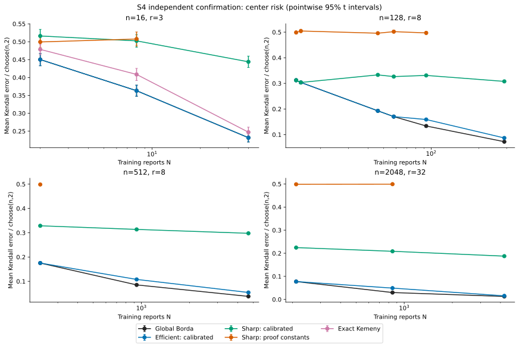
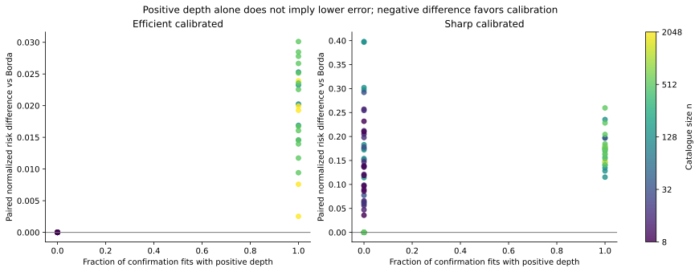
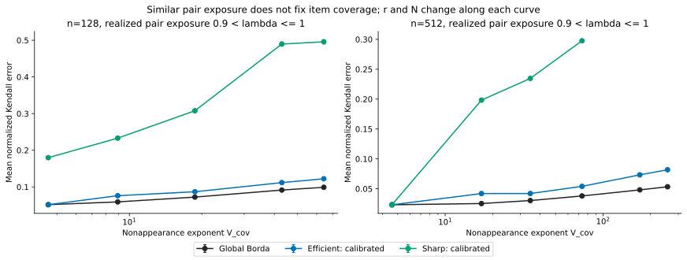
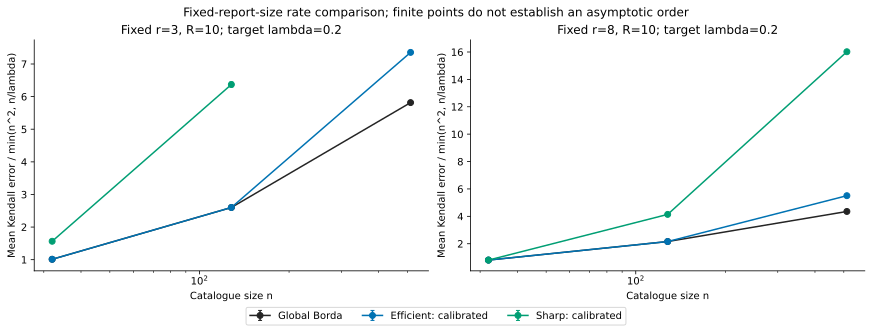
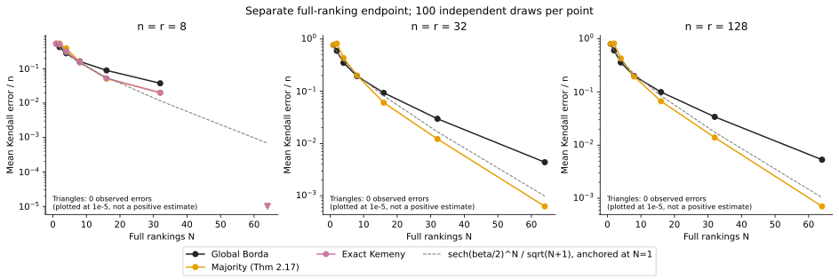
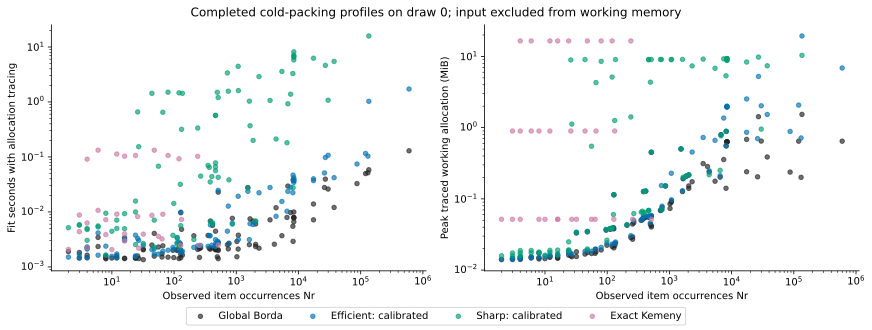

# S4: Section 4.4 risk, hierarchy and constant calibration

[Repository overview](../../README.md) · [Protocol](results/protocol.json) · [All confirmation results](results/summary.csv) · [Paired comparisons](results/paired_comparisons.csv) · [Resource measurements](results/resource_profiles.csv)

S4 is an independent simulation experiment. Its code, random streams, calibration data, confirmation data, results and figures live in this directory. It neither consumes nor overwrites P0/E0/B0 or S0–S3 fits. P0 remains the main SM–PL prediction experiment; S4 evaluates SM **center-estimation risk**, as proposed in manuscript Section 4.4, with an additional study of conservative constants.

The completed design contains **80 calibration datasets and 11,100 independent confirmation datasets**, covering **111 distinct confirmation settings, with 100 repetitions each**. A setting shared by two design panels is generated and counted once. Each method sees the same reports and true center within a repetition. These are fresh datasets, not shuffled partitions of one fixed dataset.

## Results and interpretation

The calibration selected the following fixed configurations before any confirmation data were evaluated. The two constants written as 8 in the manuscript have different roles: the tunable terminal coefficient is c_terminal=8 in the proof calibration; the geometric bound 8W from a 2W core plus 3W padding on each side remains unchanged.

| Method | A | Stage-window multiplier | Stage coefficient K | Terminal coefficient c_terminal | Calibration active / complete |
|---|---:|---:|---:|---:|---:|
| Efficient calibrated | 4 | 0.0625 | 0.3 | not used | 40/80 |
| Sharp calibrated | 4 | 0.0625 | 0.1 | 0.001953125 | 80/80 |

The selection requirement was completion on every calibration draw, positive depth on at least half of calibration draws, and—for Sharp—the exact-sieve branch on every calibration draw. Within that eligible set, selection minimized the equal-cell average of normalized Kendall error. It did not require beating Borda. This identifies a tested active configuration, not a globally optimal constant or a data-adaptive tuning rule for arbitrary future datasets.

The candidate search is an anchored set of one-factor sweeps and selected interactions, not an exhaustive search over all constants. A failure of these locked configurations to beat Borda does not prove that every possible smaller calibration must fail.

| Confirmation method | Settings complete / attempted | Completed fits with positive depth | Borda fallbacks | Lower / equal / higher mean risk than Borda, complete settings only |
|---|---:|---:|---:|---:|
| efficient_proof | 90/90 | 0 | 2600 | 0 / 90 / 0 |
| efficient_calibrated | 90/90 | 2300 | 4200 | 0 / 67 / 23 |
| sharp_proof | 60/90 | 0 | 300 | 0 / 3 / 57 |
| sharp_calibrated | 81/90 | 2772 | 1700 | 0 / 17 / 64 |

These setting counts are descriptive, not independent votes or multiple-testing-adjusted winners. The settings share design families, and one algorithm can fall back to Borda in some settings while running a hierarchy in others. Read the paired intervals and branch counts alongside mean errors. A positive depth is a computation receipt, not evidence of better estimation.

The original and calibrated versions should also be compared directly. The following counts use only settings with all 100 fits available for both versions; unavailable original sieves cannot support a paired statistical comparison.

| Calibrated versus proof version | Complete paired settings | Lower / equal / higher mean risk |
|---|---:|---:|
| Efficient | 90 | 0 / 67 / 23 |
| Sharp | 60 | 46 / 3 / 11 |

A reduction in Sharp risk relative to a coarse global sieve can coexist with higher risk than Borda. Conversely, Efficient can execute more stages without improving its final estimate. The full-data Borda benchmark uses every report for scoring; the hierarchical procedures spend fresh disjoint batches on localization, and Sharp also retains only one pair per eligible report and block. Finite-sample information loss, inaccurate pilot placement and coarse terminal sieves are plausible mechanisms. The recorded branch, exposure and displacement diagnostics describe them, but this experiment does not uniquely attribute every risk gap to one mechanism.

### Representative confirmation settings

Errors below are mean Kendall distances to the known generating center. Brackets in the difference columns are pointwise 95% t intervals across 100 independent paired draws. Negative differences favor the calibrated method. A missing risk is not replaced by the mean of successful fits.

| n,r,N | Realized lambda | Borda risk | Efficient calibrated risk | Efficient minus Borda (95% CI) | Sharp calibrated risk | Sharp minus Borda (95% CI) |
|---|---:|---:|---:|---|---:|---|
| 16,3,2 | 0.05 | 54.02 | 54.02 | 0 [0, 0] | 61.93 | 7.91 [5.728, 10.09] |
| 16,3,8 | 0.2 | 43.57 | 43.57 | 0 [0, 0] | 60.29 | 16.72 [14.32, 19.12] |
| 16,3,40 | 1 | 27.81 | 27.81 | 0 [0, 0] | 53.27 | 25.46 [23.21, 27.71] |
| 128,8,14 | 0.04823 | 2538 | 2538 | 0 [0, 0] | 2538 | 0 [0, 0] |
| 128,8,15 | 0.05167 | 2467 | 2467 | 0 [0, 0] | 2467 | 0 [0, 0] |
| 128,8,46 | 0.1585 | 1567 | 1567 | 0 [0, 0] | 2708 | 1141 [1100, 1182] |
| 128,8,58 | 0.1998 | 1383 | 1383 | 0 [0, 0] | 2653 | 1270 [1233, 1308] |
| 128,8,93 | 0.3204 | 1086 | 1291 | 205.7 [185.9, 225.4] | 2691 | 1605 [1566, 1644] |
| 128,8,290 | 0.999 | 587.3 | 705.6 | 118.3 [105.1, 131.5] | 2501 | 1914 [1880, 1947] |
| 512,32,13 | 0.04929 | 3.255e+04 | 3.255e+04 | 0 [0, 0] | 3.255e+04 | 0 [0, 0] |
| 512,32,52 | 0.1972 | 9809 | 9809 | 0 [0, 0] | 2.826e+04 | 1.845e+04 [1.823e+04, 1.868e+04] |
| 512,32,263 | 0.9972 | 3308 | 5498 | 2190 [2089, 2291] | 2.594e+04 | 2.263e+04 [2.242e+04, 2.285e+04] |
| 2048,8,3743 | 0.05 | 1.81e+05 | 2.311e+05 | 5.012e+04 [4.927e+04, 5.098e+04] | unavailable | unavailable (72/100 pairs) |
| 2048,8,14972 | 0.2 | 9.082e+04 | 1.326e+05 | 4.175e+04 [4.108e+04, 4.242e+04] | unavailable | unavailable (0/100 pairs) |
| 2048,8,74861 | 1 | 4.071e+04 | 5.662e+04 | 1.591e+04 [1.565e+04, 1.618e+04] | unavailable | unavailable (0/100 pairs) |



### What changing the constants establishes

The [complete calibration table](results/calibration_candidates.json) records the anchored one-factor sweeps and A–terminal-window interactions, including unsuccessful candidates. The original calibration, changes to A alone, and the empirical anchor are separate rows. A change to shared A also changes the terminal window by its defining formula; varying only c_terminal at fixed A isolates the terminal-window effect.

| Candidate | Family | All calibration draws complete | Positive-depth draws | Exact-sieve draws | Mean normalized risk if complete |
|---|---|---:|---:|---:|---:|
| proof | efficient | 80/80 | 0 | 0 | 0.08511 |
| proof_A128 | efficient | 80/80 | 0 | 0 | 0.08511 |
| proof_A64 | efficient | 80/80 | 0 | 0 | 0.08511 |
| proof_A8 | efficient | 80/80 | 0 | 0 | 0.08511 |
| anchor | efficient | 80/80 | 80 | 0 | 0.3115 |
| anchor_A1 | efficient | 80/80 | 0 | 0 | 0.08511 |
| anchor_A8 | efficient | 80/80 | 80 | 0 | 0.2692 |
| anchor_width1 | efficient | 80/80 | 0 | 0 | 0.08511 |
| anchor_K0.1 | efficient | 80/80 | 80 | 0 | 0.1491 |
| anchor_K0.3 | efficient | 80/80 | 40 | 0 | 0.0928 |
| anchor_KNone | efficient | 80/80 | 0 | 0 | 0.08511 |
| proof | sharp | 60/80 | 0 | 60 | unavailable |
| proof_A128 | sharp | 60/80 | 0 | 60 | unavailable |
| proof_A64 | sharp | 60/80 | 0 | 60 | unavailable |
| proof_A8 | sharp | 60/80 | 0 | 0 | unavailable |
| anchor | sharp | 80/80 | 80 | 80 | 0.4295 |
| anchor_A1 | sharp | 80/80 | 0 | 0 | 0.08511 |
| anchor_A8 | sharp | 80/80 | 60 | 80 | 0.436 |
| anchor_width1 | sharp | 80/80 | 0 | 0 | 0.08511 |
| anchor_K0.1 | sharp | 80/80 | 80 | 80 | 0.2433 |
| anchor_K0.3 | sharp | 80/80 | 40 | 40 | 0.1326 |
| anchor_KNone | sharp | 80/80 | 0 | 0 | 0.08511 |
| anchor_terminal8 | sharp | 60/80 | 80 | 60 | unavailable |
| anchor_terminal0.015625 | sharp | 40/80 | 80 | 40 | unavailable |
| anchor_terminal0.000244141 | sharp | 80/80 | 80 | 80 | 0.4295 |

Changing A alone is not sufficient in general. Smaller stopping thresholds can produce noncontracting proposed blocks; proof-sized stage batches can exceed the pilot budget. The [deterministic preflight](results/schedule_preflight.json) distinguishes these cases before outcomes are read. Such configurations retain the declared Borda fallback and are not counted as active hierarchies.

The window uses a ceiling. Different coefficients can therefore produce identical integer windows on the calibration settings and different windows at a larger catalogue or smaller report size. Calibration success does not promise exact-sieve completion under extrapolation. Confirmation uses the locked constants even when their risk worsens or their exact computation exceeds budget.

A completed sieve can also be statistically uninformative. Its radius is floor(m choose(m,2)/k), where k is the retained-pair count in a block. When that radius reaches the maximum Kendall distance, the greedy packing contains only its first permutation. This is an exact singleton sieve, not a solver failure. Smaller windows can reduce computation while leaving very few eligible reports or providing too little scope to repair pilot errors. These mechanisms are recorded in the block radii, pair counts and pilot-displacement receipts.



### Information, coverage and full rankings

At approximately fixed pair exposure, changing report size changes item coverage and within-report information. The following curves therefore describe a designed family of experiments, not a causal intervention on coverage alone. The matched-coverage panel provides the complementary comparison. Both requested panel membership and realized coordinates are in every result row.



The bounded-report-size panel fixes r at 3 or 8 and R at 10 as n grows. Its risk-to-reference ratios are descriptive finite-dimensional comparisons with min(n²,n/lambda). The displayed ratios increase with n for Borda and the selected empirical calibrations; these slices do not demonstrate a constant ratio or a sharp rate. Three finite sizes cannot establish an asymptotic exponent, and unavailable proof-calibrated sieves cannot be replaced by the calibrated variant when interpreting the original theorem. Ratios to the coverage-plus-information reference are also in summary.csv and must not be mistaken for numerical theorem constants.



Full rankings are evaluated separately using global Borda, the exact majority-tournament rule of Theorem 2.17, and exact Kemeny for n=8. The majority rule orients every tied pair once using a priority fixed before reading the reports; it does not count a tie as two predecessors. The dashed curve is the theorem rate shape, rescaled to the observed N=1 mean, not a numerical upper or lower bound. Zero observed errors in 100 draws cannot establish zero population risk: the corresponding one-sided 95% upper bound for the probability of any error is 1−0.05^(1/100), approximately 2.95%.

For example, at n=r=128 and N=64, the mean Kendall error is **0.09 for the Theorem 2.17 majority estimator versus 0.68 for Borda**. The paired difference is **−0.59**, with pointwise 95% t interval **[−0.745, −0.435]**. Thus the absence of an advantage for the calibrated partial-ranking hierarchies does not imply that Borda is the best estimator at the full-ranking endpoint. The full series and its uncertainty are retained in the result tables.



## Generating design and estimators

Every report first draws a uniform size-r subset without replacement, independently across reports. It then ranks that subset directly by Mallows insertion with independent truncated-geometric inversion variables. It never generates a full-catalogue Mallows ranking and then restricts it. Each repetition draws a fresh uniformly random true center, independently of estimator priorities. Random-center average risk is not the supremum over centers in a minimax definition.

The primary signal is beta=0.8. Signal controls use beta=0.4 or 1.6; separate beta0=0.4 controls isolate the effect of a looser supplied signal lower bound. No setting estimates beta0 from test information, and these simulations do not solve adaptation to an unknown signal lower bound.

| Panel | Design |
|---|---|
| Small exact comparisons | n=8,12,16; r=2,3,4; requested lambda=0.05,0.2,1 |
| Information and coverage | n=128,512; r=4,16,n/4; requested lambda=0.05,0.2,1 |
| Active hierarchy | n=512,2048; r=8,32,n/4; requested lambda=0.05,0.2,1 |
| Fixed bounded report size | n=32,128,512; r=3 or 8; R=10 fixed throughout |
| Matched coverage | n=128; r=2,8,16; V_cov targets 1,3,6, with integer N |
| Full ranking | n=r=8,32,128; N=1,2,4,8,16,32,64 |
| Signal and supplied bound | Representative n=128,r=8 and n=512,r=32 settings |

N is max(1, floor(lambda_target n(n−1)/(r(r−1)))) on lambda grids. Thus tiny settings can exceed a requested target after the minimum-one-report rule; results always use realized lambda. Matched coverage uses the nearest positive integer N. Deduplication prevents rounded or shared settings from creating extra evidence. The exact enumerated design is in protocol.json.

```math
\lambda=\frac{Nr(r-1)}{n(n-1)},\quad V_{\mathrm{cov}}=-N\log(1-r/n),\quad \mathbb E[U]=n\exp(-V_{\mathrm{cov}}).
```

V_cov is infinite and expected unseen items are zero when r=n. Reference shapes include min(n²,n/lambda) and n² exp(−V_cov). They have hidden theorem constants and are not numerical risk bounds. Exact Kemeny is an optimization benchmark; the sieve theorem does not automatically supply it with a logarithm-free risk guarantee.

### What is changed and what is preserved

```math
W_s=\left\lceil c_W\left(\sqrt{m_{s-1}/\eta}+1/\eta\right)\right\rceil,\qquad m_s=\min\{m_{s-1},8W_s\},\qquad \eta m_T\le A.
```

```math
M_s=\left\lceil K\eta\ell_s\frac{n(n-1)}{r(r-1)}\right\rceil,\qquad W_\star=\left\lceil c_\star A\frac{n-1}{r-1}\right\rceil.
```

The proof calibration has A=256, c_W=1, c_star=8, and K=K_star(beta0). C_T and the logarithmic factor ell_s remain the manuscript values in every configuration. The empirical sweeps change only the named constants. The core length 2W, padding 3W on each side, at-most-8W block geometry, fresh disjoint stage batches, per-depth reuse across overlapping nodes, accumulated offsets, terminal rules and final anchor sort are preserved. Noncontracting schedules are rejected; data are never reused to make an infeasible pilot appear feasible. Efficient keeps the descending resolution search; Sharp keeps eta=(r−1)/(n−1).

For Sharp, the pilot terminal orders remain arbitrary seeded orders as in Algorithm 2.1. They are not silently replaced by a full-data Borda pilot. Each unused report meeting at least two items of a sieve block contributes one uniformly selected unordered pair, selected without using its orientation. The original lexicographic greedy packing and exact disagreement minimizer are retained, including exact radius-zero and radius-one shortcuts. Sorting the fitted core anchors uses the original padded-block construction.

The comparison of numerical constants is an empirical estimator variant. Original theorem guarantees are not automatically transferred. In particular, r≤256 forces zero pilot depth for proof-calibrated Sharp because n(r−1)/(n−1)≤r≤A. Larger n alone cannot overcome that condition. For Efficient, the feasible selected resolution and the stage-sample budget matter in addition to the stopping threshold.

## Evaluation and uncertainty

The estimand is the expected Kendall distance to the known center under the specified data-generating law and estimator randomization. No train/test split is needed to observe that error. All N reports are available to each fitting procedure, which retains its internal pilot/terminal allocation. No true-center information is given to a fitted estimator. There is no PL comparison or fitted-dispersion NLL in S4.

Twenty fresh calibration draws in each of four settings select the constants. Confirmation uses a separate seed namespace and 100 fresh draws per setting. Constants remain fixed throughout confirmation; there is no per-setting best-of-grid selection.

```math
D_b=d_K(\widehat\pi_b,\pi_b^\star),\quad \overline D=\frac1B\sum_{b=1}^{B}D_b,\quad \mathrm{MCSE}=\frac{s_D}{\sqrt B},\quad \overline D\pm t_{B-1,0.975}\frac{s_D}{\sqrt B}.
```

Independent datasets make repetitions independent Monte Carlo observations. Student-t intervals are approximate pointwise intervals for the mean of this simulation procedure; they are not finite-sample risk bounds or simultaneous bands. The paired comparison uses D_method,b−D_reference,b before taking the mean and sample standard deviation. Its additional percentile bootstrap resamples the 100 whole paired repetitions with replacement 2,000 times. Pairs inside one report are never treated as independent bootstrap units. Intervals for calibrated methods condition on the locked selection; they do not include the variability of repeating the entire calibration-and-selection stage.

If any planned repetition is unavailable, the full-setting mean, MCSE and CI for that method are unavailable. The CSV separately labels any conditional mean over completed fits. Failed draws are not rerolled or replaced. Borda fallback is an explicitly defined algorithm branch and is reported as such, rather than relabeled as an active sieve.

## Computation and reproducibility

There is no item-count cutoff of eight for a sieve. The declared implementation budget is 512 MiB per exact packing/DP admission, 30 seconds per packing, and 120 seconds across terminal sieves. These are computational budgets, not theorem conditions. Failed-block receipts preserve the estimated size, reason, window and pair counts. Full enumeration can still be infeasible after a window is smaller than its proof value.

The implementation streams report-to-node memberships for block scoring and indexes eligible reports for pair extraction. Tests compare the optimized operations with the literal implementation, including positive-depth overlap and offsets. These optimizations do not change the estimator.



Risk-run wall times include reuse of an on-disk packing cache and concurrent workers. Resource profiles are separate fresh-process, cold-packing runs on confirmation repetition zero. Their times include allocation-tracing overhead and are descriptive measurements on the recorded machine, not universal complexity constants. Peak traced working allocation excludes the already-materialized input and imported interpreter/libraries; the CSV also reports input bytes and their sum. Python and NumPy allocations are traced; this is not a claim to measure every native-library byte or total process RSS.

The resource figure shows completed draw-zero fits only; unsuccessful profiles remain in the CSV. At most two profile processes ran concurrently, overlapping the last risk worker. These measurements are suitable for descriptive comparisons, not precise machine-independent scaling exponents.

```bash
# From the repository root, using requirements-lock.txt.
export OPENBLAS_NUM_THREADS=1 OMP_NUM_THREADS=1 PYTHONINTMAXSTRDIGITS=0
python -m pytest -q experiments/section44/test_core.py
python experiments/section44/validate.py --quick

# Reproduce the independent experiment (may take substantial time).
python experiments/section44/run.py preflight
python experiments/section44/run.py calibrate
python experiments/section44/run.py confirm
python experiments/section44/resources.py
python experiments/section44/report.py
python experiments/section44/write_report.py
python experiments/section44/finalize.py
python experiments/section44/validate.py
```

PYTHONINTMAXSTRDIGITS=0 permits exact factorial-size resource receipts for very large permutation spaces; it does not change a fit or remove a memory limit. The runners resume only matching code/protocol receipts. Private working caches live under results/private/section44 and are not part of another experiment. The public draw archives retain true centers, fitted orders, complete schedules and failure receipts, stream keys and report hashes. Raw reports are regenerated exactly from the declared generator and seed, rather than storing many duplicate megabytes.

## Artifact guide and references

| File | Contents |
|---|---|
| results/protocol.json | Predeclared cells, grids, sample budgets, stream namespaces and selection rule |
| results/producer.json | Base commit, input code hashes and runtime versions |
| results/selection.json | Locked winners, using calibration only |
| results/calibration_candidates.json; calibration_summary.csv | Every candidate, completion and depth; all one-factor comparisons |
| results/summary.csv | Complete-setting risk, pointwise intervals, branch counts, exposure and time |
| results/paired_comparisons.csv | Paired differences versus Borda, available exact Kemeny and proof-calibrated versions; t and bootstrap intervals |
| results/confirmation_fits.csv.gz; calibration_fits.csv.gz | One row per attempted fit |
| results/draws/ | Full independent draw receipts, including fitted orders and unavailable cases |
| results/resource_profiles.csv | Separate fresh-process time and working-memory profiles |
| results/schedule_preflight.json | Outcome-independent schedule and budget checks |
| results/manifest.json | Byte hashes for code, reports, figures and results |

The manuscript is *Selective Mallows Estimation from Uniform Partial Rankings: Minimax Kendall Risk, Efficient Algorithms, and Likelihood Comparisons*, supplied 37-page version with SHA256 `400563b1789acbeea985e4b4c551162b64c87295ee3a7bf91037c8d4cc49e676`. Section 4.4 (p. 36) specifies this simulation agenda; Algorithm 2.1 (p. 5) defines Sharp; Lemma 2.11 defines the permutation sieve; equation (3.4) defines the Borda scores; Algorithms 3.1/3.2 and equations (3.22)–(3.23) define the efficient hierarchy and proof calibration; Section 3.6 discusses empirical constants and streaming cost; Theorem 2.17 gives the full-ranking majority estimator and rate. The supplied manuscript is not redistributed here. [Repository reference catalogue](../../docs/references.md).
