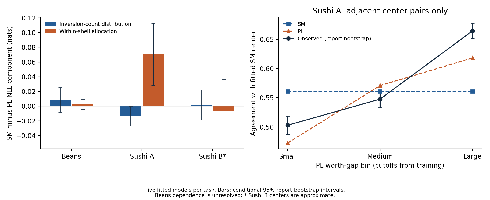

# C1: diagnostics on five fixed-test fits

[Design](../../docs/structural_controls.md#pair-shell-and-context-diagnostics-on-saved-fits) · [Shell decomposition](shell_decomposition.csv) · [Pair losses](pair_diagnostics.csv) · [Context slopes](context_effects.csv) · [Per-fit diagnostics](context_replicates.csv) · [Manifest](manifest.json)

These diagnostics use five saved L1 fits for every task, including Sushi B. The main budgets are Beans N=673 and Sushi A/B N=3000; Beans N=20 additionally supplies a dispersion-shrinkage shell control. No new ranking-model fit or outer allocation is performed here. The diagnostic collection is supplementary and does not select P0's predictors.

Shell-mass and within-shell contributions sum exactly to each whole-ranking SM−PL NLL difference. Pair log/Brier losses average within reports before averaging across reports; pairs within a ranking are not independent sampling units. Adjacent-pair strength-bin boundaries come from training reports. Context slopes compare the same pair across displayed-center gaps, optionally within Beans season or Sushi B region. Sushi A's fixed display has no such contrast.

All report contributions are first averaged across the five fixed fits. Shared report-bootstrap indices retain covariance between models, within-report pairs and fit contributions. Context slopes are recomputed within each draw, while ranking-model parameters and diagnostic eligibility are fixed. The 2,000-draw percentile intervals remain exploratory, conditional on the fitted collection and source-sampling assumptions. Sparse overlap, estimated centers and data-dependent eligibility limit calibration. Beans lacks farmer IDs; its stored endpoints are descriptive and do not justify independent-person inference. Bootstrap draws are not additional training repetitions.

Reproduce with `python controls/l1/diagnostics.py`, then `python controls/l1/validate_diagnostics.py --write-manifest`. Read-only validation omits `--write-manifest`. Inputs are the [current L1 parameters](../regularized_learning/fitted_parameters.json); source data remain local. The common-order and fixed optimization benchmarks are separately identified in the C1 design.
