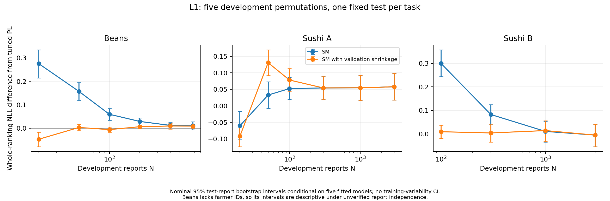

# L1: fixed-test learning and regularization control

[Design](../../docs/learning_curves.md) · [Summary](real_summary.csv) · [All 80 fits](real_replicates.csv) · [Parameters](fitted_parameters.json) · [Manifest](manifest.json)

Beans and Sushi A each have six training budgets; Sushi B has four. Every budget uses five nested development-pool permutations (IDs 0–4), with one fixed outer test per task. Sushi A/B share respondent allocations. N includes inner validation. This is a supplementary control; P0 alone is the Algorithm 4.1 main comparison.

The compared predictions are bounded-dispersion SM, training-validation-shrunk SM, tuned ridge PL and near-unpenalized positive-ridge PL. Exact subset DP fits Beans/Sushi A centers; Sushi B uses insertion plus time-limited integer optimization and records its objective bounds. A nonzero gap is approximate. No estimator is selected using test loss.

First average each fixed test report's paired loss across five fitted models. Resample these report averages with replacement 2,000 times, and take the 2.5th/97.5th percentiles. The saved nominal 95% intervals condition on this model collection and test-sampling assumptions; they do not include training variability or outer-partition uncertainty. Beans' unavailable farmer identities prevent a verified independent-person interpretation. These intervals are not population CIs for a five-split learning procedure.

`real_replicates.csv` retains each fit's numerical status, PL gradient residual, center certificate, unseen-item count, selected penalty and shrinkage multiplier. Positive ridge guarantees a finite mathematical optimum; the recorded numerical solution is still approximate. The near-MLE control uses a positive penalty 1e-6 and is not unpenalized Hunter MM.

```bash
python controls/l1/run.py
python controls/l1/validate.py --write-manifest --sources
```

The isolated `controls/l1/src` namespace preserves this control's fitting procedures. Public-only validation uses `python controls/l1/validate.py`; full source replay also checks all memberships, all four saved predictions, and 48 bootstrap intervals from the local ignored caches.


